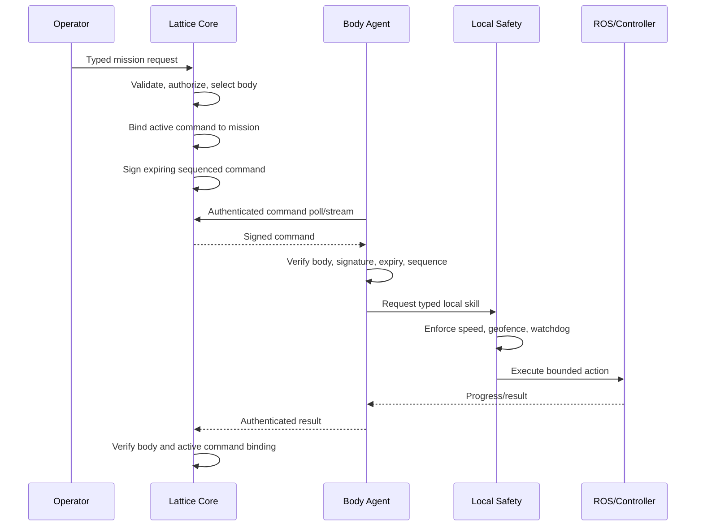

# Architecture

## Dependency rule

```text
Transport and infrastructure
            ↓
Application use cases and ports
            ↓
Pure domain entities and invariants
```

The domain crate performs no I/O and depends on no framework. Application code
coordinates use cases through ports. Infrastructure implements those ports.

## Why a modular monolith

The trusted core starts as one Rust deployable with explicit modules. This keeps
transactions, debugging, local development, and incident analysis straightforward.
A module becomes a service only when measured scaling, ownership, availability,
or isolation requirements justify the operational cost.

## Process boundaries

- `lattice-core-api`: trusted orchestration, policy, state transitions, signing
- `lattice-mock-body`: simulated signature-verifying embodiment
- `lattice-ros2-gateway`: local C++ robotics boundary
- `lattice-ai-gateway`: untrusted proposal-only AI process
- `control-center`: untrusted operator browser
- PostgreSQL: durable source of truth
- NATS JetStream: durable event distribution
- OpenTelemetry Collector: telemetry egress

## Frontend architecture

```text
React application
├── API boundary
│   ├── fetch wrapper
│   └── Zod runtime validation
├── TanStack Query
│   ├── bodies
│   ├── missions
│   └── audit
├── XState
│   └── mission approval workflow
├── Product features
│   ├── fleet
│   ├── missions
│   ├── audit
│   └── digital twin
└── Lazy-loaded React Three Fiber scene
```

No Redux or Next.js runtime is included. Server state remains in TanStack Query;
workflow legality remains in XState; transient view state remains local React state.

## Command flow



## Data strategy

The durable local runner uses PostgreSQL as the source of truth. Transaction-scoped
ports commit approval, mission, command, sequence, audit and outbox rows together.
A session advisory lock enforces one core writer. Startup holds unfinished work
for a new operator approval and preserves signing identity. See
[restart recovery](RECOVERY_DEMO.md). The original runner remains in-memory.
Outbox publication to NATS is not implemented yet.

Current bounded inspection JPEGs are retained in mission JSONB. Large evidence—
video, maps, MCAP and rosbag data—will require object storage, retention and
authorization controls.
